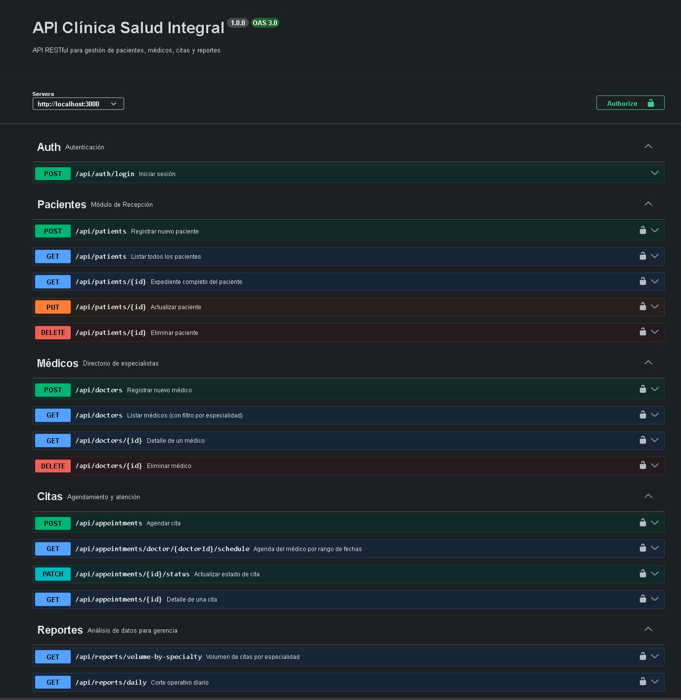
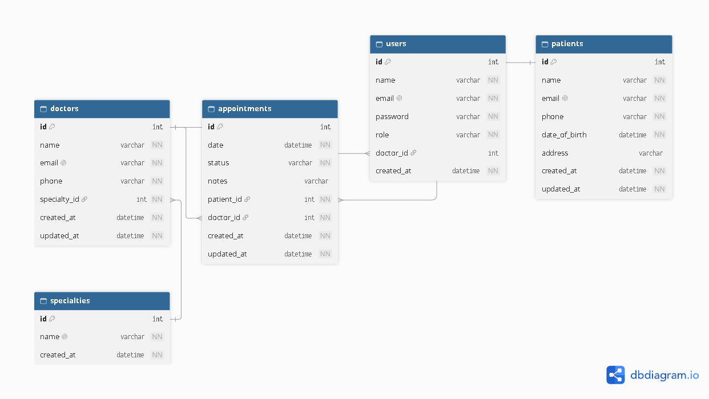

# 🏥 Clínica Salud Integral — API RESTful
[](https://github.com/oscarvirgen777/Clinica-Salud-Integral/actions)
[]()
[]()
[]()
[]()

API RESTful para la gestión de pacientes, médicos, citas y reportes de una clínica médica. Diseñada como núcleo para futuras aplicaciones de recepcionistas, médicos y gerencia.

## 🚀 Images Ilustrativas




## 🚀 Stack Tecnológico

| Tecnología | Propósito |
|------------|-----------|
| Node.js + TypeScript | Lenguaje y tipado |
| Express | Framework HTTP |
| Prisma 7 (ORM) | Acceso a datos |
| PostgreSQL 16+ | Base de datos relacional |
| Zod | Validación de entrada |
| JWT + bcryptjs | Autenticación y hash |
| Swagger UI | Documentación de API |
| Vitest + Supertest | Tests automatizados |
| pnpm | Gestor de paquetes |
| Docker | Containerización |

## 📋 Problemática

La Clínica "Salud Integral" operaba con hojas de cálculo, lo que provocaba pérdida de datos y cruce de horarios. Esta API resuelve la problemática centralizando toda la información en una base de datos relacional con control de acceso por roles.

## 👥 Roles

| Rol | Permisos |
|-----|----------|
| `RECEPCIONISTA` | Alta de pacientes, agendar citas, registrar médicos |
| `MEDICO` | Ver agenda propia, actualizar estado de citas propias |
| `GERENCIA` | Reportes de volumen por especialidad y corte diario |

## 📁 Estructura del Proyecto
   
```text
Estructura del Proyecto
├── prisma/
│   ├── schema.prisma           # Modelo de datos
│   ├── migrations/             # Migraciones SQL
│   ├── seed.ts                 # Datos de prueba
│   └── generated/              # Prisma Client (auto-generado)
├── src/
│   ├── index.ts                # Punto de entrada
│   ├── app.ts                  # Configuración de Express
│   ├── config/
│   │   ├── prisma.ts           # Instancia de PrismaClient
│   │   └── swagger.ts          # Swagger UI
│   ├── middlewares/
│   │   ├── auth.middleware.ts       # Verificación de JWT
│   │   ├── authorize.middleware.ts  # Autorización por rol + ownership
│   │   ├── error.middleware.ts      # Manejo global de errores
│   │   └── validate.middleware.ts   # Validación con Zod
│   ├── errors/
│   │   ├── AppError.ts              # Clase base de errores
│   │   ├── NotFoundError.ts         # 404
│   │   └── UnauthorizedError.ts     # 401
│   ├── utils/
│   │   └── logger.ts                # Logger con niveles
│   └── modules/
│       ├── auth/                    # Login (JWT + bcrypt)
│       ├── patients/                # CRUD + expediente
│       ├── doctors/                 # Directorio + filtro por especialidad
│       ├── appointments/            # Agendamiento + gestión de estado
│       └── reports/                 # Reportes de gerencia
├── src/tests/             # Tests automatizados
├── Dockerfile
├── docker-compose.yml
├── prisma.config.ts
└── .env.example
```   

## 🏗️ Arquitectura

Cada módulo sigue el patrón **routes → controller → service**:

| Capa | Responsabilidad |
|------|----------------|
| Routes | Middlewares (auth, authorize, validate) + JSDoc Swagger |
| Controller | Extrae datos ya validados, delega al service, responde HTTP |
| Service | Queries a BD (Prisma) + reglas de negocio |

Middlewares transversales:

| Middleware | Función |
|-----------|---------|
| `verifyToken` | Verifica JWT (firma + expiración) → inyecta `req.user` |
| `authorize(...roles)` | Verifica que el rol del token esté en la lista permitida → 403 |
| `ownDoctorResource()` | Un médico solo accede a su propia agenda (compara `doctorId` del token vs URL) |
| `ownAppointment()` | Un médico solo modifica sus citas (query a BD para verificar ownership) |
| `validate(schema, source)` | Valida entrada con Zod → 400 si falla |
| `errorHandler` | Captura cualquier throw → JSON con statusCode correcto |

## 📦 Instalación

### Prerequisites

- Node.js 20+
- pnpm 10+
- PostgreSQL 16+

### Pasos

```bash
# 1. Clonar el repositorio
git clone https://github.com/oscarvirgen777/Clinica-Salud-Integral.git
cd Clinica-Salud-Integral

# 2. Instalar dependencias
pnpm install

# 3. Configurar variables de entorno
cp .env.example .env
# Editar .env con tus credenciales de PostgreSQL

# 4. Crear base de datos
# (en psql)
CREATE DATABASE clinica_salud;
CREATE USER clinica_user WITH PASSWORD 'clinica_pass' CREATEDB;
GRANT ALL PRIVILEGES ON DATABASE clinica_salud TO clinica_user;

# 5. Ejecutar migraciones
pnpm prisma migrate dev

# 6. Cargar datos de prueba
pnpm prisma db seed

# 7. Arrancar la API
pnpm dev   

 #DOCKER ALTERNATIVA
docker compose up --build
# API en http://localhost:3000
# BD en localhost:5432 (volumen persistido)   