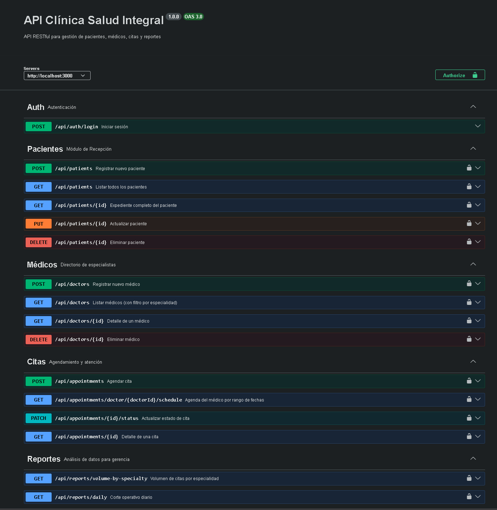
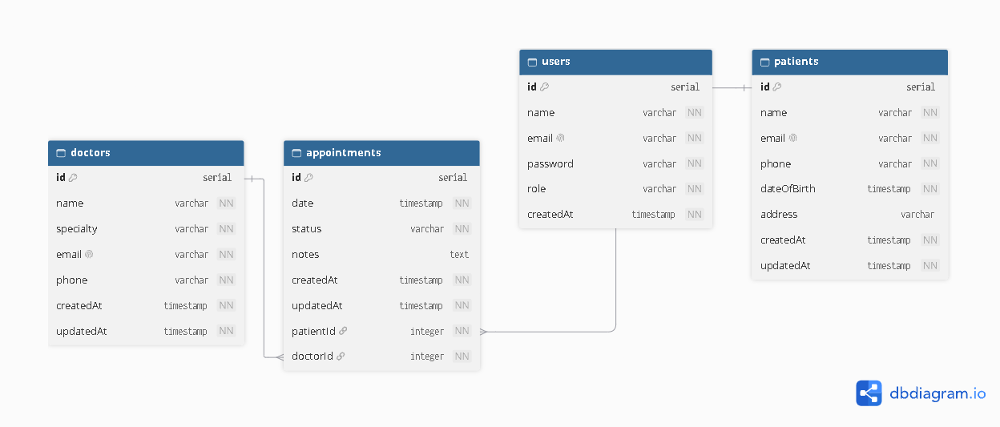

# 🏥 Clínica Salud Integral — API RESTful
[](https://github.com/oscarvirgen777/Clinica-Salud-Integral/actions)   
[]()
[]()
[]()
[]()

API RESTful para la gestión de pacientes, médicos, citas y reportes de una clínica médica. Diseñada como núcleo para futuras aplicaciones de recepcionistas, médicos y gerencia.
## 🚀 Images Ilustrativas


   



## 🚀 Stack Tecnológico

| Tecnología | Propósito |
|------------|-----------|
| Node.js + TypeScript | Lenguaje y tipado |
| Express | Framework HTTP |
| Prisma 7 (ORM) | Acceso a datos |
| PostgreSQL | Base de datos relacional |
| Zod | Validación de entrada |
| JWT + bcryptjs | Autenticación y hash |
| Swagger UI | Documentación de API |
| Vitest + Supertest | Tests automatizados |
| pnpm | Gestor de paquetes |

## 📋 Problemática

La Clínica "Salud Integral" operaba con hojas de cálculo, lo que provocaba pérdida de datos y cruce de horarios. Esta API resuelve la problemática centralizando toda la información en una base de datos relacional con control de acceso por roles.

## 👥 Roles

| Rol | Permisos |
|-----|----------|
| `RECEPCIONISTA` | Alta de pacientes, agendar citas, registrar médicos |
| `MEDICO` | Ver agenda, actualizar estado de citas |
| `GERENCIA` | Reportes de volumen por especialidad y corte diario |

## 📁 Estructura del Proyecto

```
├── prisma/
│   ├── schema.prisma              # Modelo de datos
│   ├── migrations/                # Migraciones SQL
│   └── seed.ts                    # Datos de prueba
├── generated/                     # Prisma Client (auto-generado)
├── src/
│   ├── index.ts                   # Punto de entrada
│   ├── app.ts                     # Configuración de Express
│   ├── config/
│   │   ├── prisma.ts              # Instancia de PrismaClient
│   │   └── swagger.ts             # Swagger UI
│   ├── middlewares/
│   │   ├── auth.middleware.ts     # Verificación de JWT
│   │   ├── authorize.middleware.ts# Autorización por rol
│   │   ├── error.middleware.ts    # Manejo global de errores
│   │   └── validate.middleware.ts # Validación con Zod
│   ├── errors/
│   │   ├── AppError.ts
│   │   ├── NotFoundError.ts
│   │   └── UnauthorizedError.ts
│   ├── utils/
│   │   └── logger.ts
│   └── modules/
│       ├── auth/                  # Login
│       ├── patients/              # CRUD + expediente
│       ├── doctors/               # Directorio + filtro por especialidad
│       ├── appointments/          # Agendamiento + gestión de estado
│       └── reports/               # Reportes de gerencia
├── src/__tests__/                 # Tests automatizados
├── Dockerfile
├── docker-compose.yml
├── prisma7.config.ts
└── .env.example
```   

## 📦 Instalación

### Prerequisites

- Node.js 20+
- pnpm 10+
- PostgreSQL 16+

### Pasos

```bash
# 1. Clonar el repositorio
git clone https://github.com/tu-usuario/clinica-salud-integral.git
cd clinica-salud-integral

# 2. Instalar dependencias
pnpm install

# 3. Configurar variables de entorno
cp .env.example .env
# Editar .env con tus credenciales de PostgreSQL

# 4. Crear base de datos
# (en psql)
CREATE DATABASE clinica_salud;
CREATE USER clinica_user WITH PASSWORD 'clinica_pass' CREATEDB;
GRANT ALL PRIVILEGES ON DATABASE clinica_salud TO clinica_user;

# 5. Ejecutar migraciones
pnpm prisma migrate dev

# 6. Cargar datos de prueba
pnpm prisma db seed

# 7. Arrancar la API
pnpm dev


📡 Endpoints
Auth
Método	Ruta	Rol	Descripción
POST	/api/auth/login	Público	Login → JWT

Pacientes
Método	Ruta	Rol	Descripción
POST	/api/patients	RECEPCIONISTA	Registrar paciente
GET	/api/patients	Autenticado	Listar pacientes
GET	/api/patients/:id	Autenticado	Expediente completo (con citas)
PUT	/api/patients/:id	RECEPCIONISTA	Actualizar paciente
DELETE	/api/patients/:id	RECEPCIONISTA	Eliminar paciente

Médicos
Método	Ruta	Rol	Descripción
POST	/api/doctors	RECEPCIONISTA	Registrar médico
GET	/api/doctors?specialty=	Autenticado	Listar/filtrar por especialidad
GET	/api/doctors/:id	Autenticado	Detalle de médico
DELETE	/api/doctors/:id	RECEPCIONISTA	Eliminar médico

Citas
Método	Ruta	Rol	Descripción
POST	/api/appointments	RECEPCIONISTA	Agendar cita
GET	/api/appointments/doctor/:id/schedule?from=&to=	MEDICO	Agenda por rango de fechas
PATCH	/api/appointments/:id/status	MEDICO	Cambiar estado (COMPLETADA/CANCELADA)
GET	/api/appointments/:id	Autenticado	Detalle de cita

Reportes
Método	Ruta	Rol	Descripción
GET	/api/reports/volume-by-specialty	GERENCIA	Citas agrupadas por especialidad
GET	/api/reports/daily?date=YYYY-MM-DD	GERENCIA	Corte operativo diario

🔐 Autenticación
Todos los endpoints (excepto /api/auth/login) requieren un token JWT en el header:

Authorization: Bearer <token>

El token se obtiene con POST /api/auth/login y expira a las 8 horas.

📐 Modelo de Datos
users (1) ──── (N) appointments
patients (1) ──── (N) appointments
doctors (1) ──── (N) appointments

users: id, name, email, password (hashed), role
patients: id, name, email, phone, dateOfBirth
doctors: id, name, specialty, email, phone
appointments: id, date, status, notes, patientId, doctorId
✅ Reglas de Negocio Implementadas
Fecha de nacimiento no puede ser futura
No se puede agendar cita en fecha pasada
Citas nacen con estado PROGRAMADA
Solo MEDICO puede cambiar estado a COMPLETADA o CANCELADA
Solo GERENCIA puede acceder a reportes
Email único por paciente y por médico
🧪 Tests
pnpm test

12 tests cubriendo:

Expediente del paciente (con citas)
Alta de paciente (validaciones de email y fecha)
Agendamiento de citas (regla de fecha pasada)
Cambio de estado de cita
Reportes de gerencia (por especialidad y corte diario)
Control de acceso por rol
📖 Documentación Interactiva
Con la API corriendo, abre:

http://localhost:3000/api/docs

🔑 Variables de Entorno
Variable	Descripción
DATABASE_URL	String de conexión a PostgreSQL
JWT_SECRET	Secreto para firmar tokens
PORT	Puerto del servidor (default: 3000)
